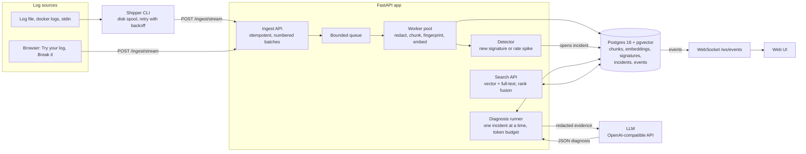

# FailureLens

**Real-time log ingestion, failure detection and RAG root-cause diagnosis — with a live dashboard, running on free tooling only.**

Logs stream in, get redacted, chunked and fingerprinted into failure signatures, and embedded for hybrid search (pgvector + Postgres full-text). When an error is new or spiking, an incident opens and an LLM writes a root cause backed by quoted log lines.

Describe a failure in plain words — *"server was deleted"*, *"how long did it take to build the VM"* — and FailureLens finds the log lines that explain it. If it's a new or spiking error, an incident opens on the live dashboard with a diagnosis and evidence.

---

## Why it's free to run

| Piece | How | Cost |
| --- | --- | --- |
| Embeddings | `bge-small-en-v1.5` (384d) via ONNX Runtime **on your CPU** | **$0** — no API key |
| Search | pgvector + Postgres full-text (no Elasticsearch) | **$0** |
| Diagnosis | any OpenAI-compatible chat API — defaults use Google's **free Gemini tier** | **$0** with the free tier |
| Dashboard | included Vite frontend | **$0** |

No LLM key? Everything still works — search, ingestion, incidents — they just show **"No diagnosis yet"**.

## Quick start (Docker)

**1. Get the embedding model** (two files, folder is gitignored):

```powershell
New-Item -ItemType Directory -Force models\bge-small-en-v1.5 | Out-Null
Invoke-WebRequest https://huggingface.co/BAAI/bge-small-en-v1.5/resolve/main/onnx/model.onnx -OutFile models\bge-small-en-v1.5\model.onnx
Invoke-WebRequest https://huggingface.co/BAAI/bge-small-en-v1.5/resolve/main/tokenizer.json -OutFile models\bge-small-en-v1.5\tokenizer.json
```

**2. Start everything:**

```bash
docker compose up -d --build
curl http://localhost:8000/health
```

`/health` should report `"status": "ok"` and `"embedding": {"provider": "local", "configured": true}`.

Compose mounts `./models` read-only at `/models` and sets `LOCAL_MODEL_DIR=/models/bge-small-en-v1.5`. The image is Python 3.12 and installs the `local` extra.

**3. Try it in 2 minutes:**

1. Open **http://localhost:8000/** → *Upload a log file* and add a log (tested with the `OpenStack_2k` sample).
2. Try these searches:

- `database has 1 instance but hypervisor has 0`
- `server was deleted`
- `how long did it take to build the VM`
- `base file removed`
- `no instances found for event`
- `banana bread recipe` → correctly answers *"I don't know"*

3. Open **Break it** in the menu and press the button. It streams fake errors for a pretend service, an incident opens, and the Incidents page shows the diagnosis with evidence.

## Architecture



### How a failure becomes a diagnosis

1. **Ship.** The shipper tails a file, stdin or `docker logs`, writes numbered batches to a disk spool, and sends them with retry and backoff. A batch is deleted only after the server confirms its key as committed, so a server outage loses nothing.
2. **Ingest.** `POST /ingest/stream` accepts a batch (202) and puts it on a bounded queue. Idempotency keys make resends safe.
3. **Process.** Workers redact secrets and personal data, cut the lines into chunks, fingerprint each error into a signature, embed the chunk, and write everything to Postgres in one transaction.
4. **Detect.** For an ERROR-or-higher signature, the detector opens an incident when the signature is new, or when its rate in the last 5 minutes is at least 5 times its baseline. A unique index allows one active incident per signature.
5. **Diagnose.** The runner claims one incident (`FOR UPDATE SKIP LOCKED`), gathers evidence, redacts it again, checks the hourly token budget, and asks the LLM for strict JSON.
6. **Verify.** Every quoted evidence line must appear character for character in the chunk it cites. Lines that do not are dropped. If none survive, or the model says "inconclusive", the incident shows no cause.
7. **Publish.** The result is saved on the incident and an event goes out over `/ws/events` to the dashboard.

| Path | What it is |
| --- | --- |
| `app/` | FastAPI backend: ingest queue, worker pool, fingerprinting, retrieval, incidents, WebSocket events, `/metrics` |
| `shipper/` | Log shipper CLI: tails files, spools to disk, forwards with backoff, resumes from committed keys |
| `frontend/` | Live dashboard (Vite dev server on port 5173) |
| `alembic/` | Database migrations (Postgres 16 + pgvector) |
| `eval/` | Retrieval eval harness and load test |

**Main endpoints** — note there is **no `/api` prefix**:

| Endpoint | What it does |
| --- | --- |
| `POST /ingest/stream` | Ingest one raw log line (`text/plain`) |
| `GET /signatures` | Failure signatures |
| `GET /incidents` | Diagnosed incidents |
| `WS /ws/events` | Live dashboard events |
| `POST /diagnose` | Ask for a diagnosis in plain words |
| `GET /health` · `GET /metrics` | Health and Prometheus metrics |

Search and document-upload routers live in `app/api/`.

## Local development

Python **3.12+** is required for the `local` extra (the numpy pin needs it).

```bash
python -m venv .venv
.venv\Scripts\activate            # Windows; on Linux/macOS: source .venv/bin/activate
pip install -e ".[dev,local]"
docker compose up -d db             # Postgres on host port 55432
alembic upgrade head
uvicorn app.main:app --reload
```

Frontend:

```bash
cd frontend
npm install
npm run dev                         # http://localhost:5173
```

Ship logs with `python -m shipper --help`.

## Configuration

Copy `.env.example` to `.env`. Every setting is optional; the file lists the defaults. Notables:

| Variable | Default | Notes |
| --- | --- | --- |
| `EMBEDDING_PROVIDER` | `local` | `local` is free; `fake` is for tests |
| `LOCAL_MODEL_DIR` | `models/bge-small-en-v1.5` | point at a different model folder |
| `MIN_SIMILARITY` | `0.65` | minimum vector-only similarity to count as evidence; per-request overridable |
| `LLM_API_KEY` / `LLM_BASE_URL` / `LLM_MODEL` | free Gemini tier | any OpenAI-compatible chat API |
| `LLM_HOURLY_TOKEN_CAP` | — | diagnoses wait when the cap is hit (~28/h at 50k tokens, ~1.7k per diagnosis) |
| `DATABASE_URL` | compose default | Postgres connection |

**LLM key** (optional): get one at https://aistudio.google.com and put it in your local `.env` as `LLM_API_KEY=` — never commit it. Without a key the diagnosis runner is disabled and `/diagnose` answers `503`; everything else works.

**Embedding details:** long chunks are embedded as several windows and grouped back per chunk (no truncation). Local vectors live in their own table (`chunk_embeddings_local`). `MIN_SIMILARITY` was tuned on 11 eval cases for bge-small only (answerable 0.708 → 0.851, off-topic 0.594 → 0.689) — treat it as provisional.

## Testing

```bash
pytest -q -m "not integration"                       # unit tests, no database needed
docker compose --profile test up -d --wait db-test   # throwaway Postgres on port 55433
pytest -q -m integration                             # DB-backed tests
ruff check .
```

## Does it work? — measured results

**Retrieval eval** over Loghub samples (HDFS, OpenStack). Refuses any database whose name does not end in `_eval`. Committed results (`eval/results/`), 6 cases from 3 problems:

| Mode | Hits |
| --- | --- |
| Vector, windowed | **6/6** |
| Hybrid (vector + full-text, RRF) | 5/6 |
| Full-text only | 3/6 |
| Vector, truncated (old behaviour) | 4/6 |

Six cases are too few to rank modes — read this as *"windowing fixed truncation"*, not *"vector beats hybrid"*.

**Search quality**: test set `eval/fixtures/webshop/webshop-incident-day.log` (572 lines, 8 injected failures), 8 plain-words queries (e.g. *"server disk is full"*). A query passes when the right log line is in the top 3, searched across all uploaded files:

| Change | Top-3 hits (of 8) |
| --- | --- |
| Baseline (hybrid vector + full-text) | 5 |
| ERROR/WARN level boost | 6 |
| Redaction fix: plain words after `token:` are no longer hidden | **7** |

Searching one file only (the *All files / this file* dropdown) scored 7/8 when measured before the redaction fix (not re-measured since). The redaction fix mattered because `failed to store session token: Redis is out of memory` was stored as `<SECRET> is out of memory` — unfindable by any search.

**Tried and dropped:** query rewriting with a free Gemini model (+1 query, but one model call per search, and no gain once search is scoped to one file); removing filler words from the full-text query (net zero).

**Caveats:** 8 queries on one synthetic log is a small sample — treat these numbers as a regression check, not an accuracy claim. The level boost changed one result for the demo query `"server was deleted"` (an unrelated nginx WARN line entered the top 3).

**Load test**: `eval/load_test.py` — 1000 lines/s for 60 s, **0 lost** in the committed run.

## Known limitations

- **Full-text search does not stem** (Postgres `simple` config on purpose, so `blk_123` and `nova.virt.libvirt` stay intact). A query using a different word form (`instance` vs `instances`) can lose its vector hit during hybrid fusion. A separate stemmed column would fix it, but needs more eval cases first.
- **Diagnosis needs an LLM key** — without one, incidents still open but show "No diagnosis yet".
- **Diagnosis only looks inside the failing service.** If service A fails because of service B, the answer is "inconclusive" or wrong (seen on the cart-api scenario).
- **Diagnosis can claim a cause when nothing was logged.** If the logs show only the failure and no explaining line, the model sometimes restates the symptom instead of saying "inconclusive". In 3 runs of the email-digest scenario, 3 of 6 diagnoses were correct.
- **One failure can open more than one incident** — each distinct error message is its own signature, so one *Break it* click can produce two incidents.
- **Small "before the error" context**: at most 4 distinct lines from the same service in the 30 minutes before the error. An older or buried cause can be missed.
- **Diagnoses wait at the hourly token cap** (`LLM_HOURLY_TOKEN_CAP`) — roughly 28 diagnoses/hour at a 50k cap.
- **Diagnosis scores come from a few synthetic scenarios**, each run twice, plus one hand-written log. A trend, not an accuracy rate.
